# Segments

## Setup

### Packages

``` r

library(ggdiagram)
library(ggplot2)
library(dplyr)
#> 
#> Attaching package: 'dplyr'
#> The following objects are masked from 'package:stats':
#> 
#>     filter, lag
#> The following objects are masked from 'package:base':
#> 
#>     intersect, setdiff, setequal, union
library(ggtext)
library(ggarrow)
library(arrowheadr)
```

### Base Plot

To avoid repetitive code, we make a base plot:

``` r

my_font <- "Roboto Condensed"
my_font_size <- 20
my_point_size <- 2

# my_colors <- viridis::viridis(2, begin = .25, end = .5)
my_colors <- c("#3B528B", "#21908C")

theme_set(
  theme_minimal(base_size = my_font_size, base_family = my_font) +
    theme(axis.title.y = element_text(angle = 0, vjust = 0.5))
)

bp <- ggdiagram(
  font_family = my_font,
  font_size = my_font_size,
  point_size = my_point_size,
  linewidth = 0.5,
  theme_function = theme_minimal,
  axis.title.x =  element_text(face = "italic"),
  axis.title.y = element_text(
    face = "italic",
    angle = 0,
    hjust = 0.5,
    vjust = 0.5
  )
) +
  scale_x_continuous(labels = signs_centered, limits = c(-4, 4)) +
  scale_y_continuous(labels = signs::signs, limits = c(-4, 4))
```

## Specifying a segment

A segment is a portion of a line between two points.

``` r

bp + 
  {p1 <- ob_point(-3, -1)} +
  {p2 <- ob_point(3, 3)} +
  {s1 <- ob_segment(p1, p2)}
```

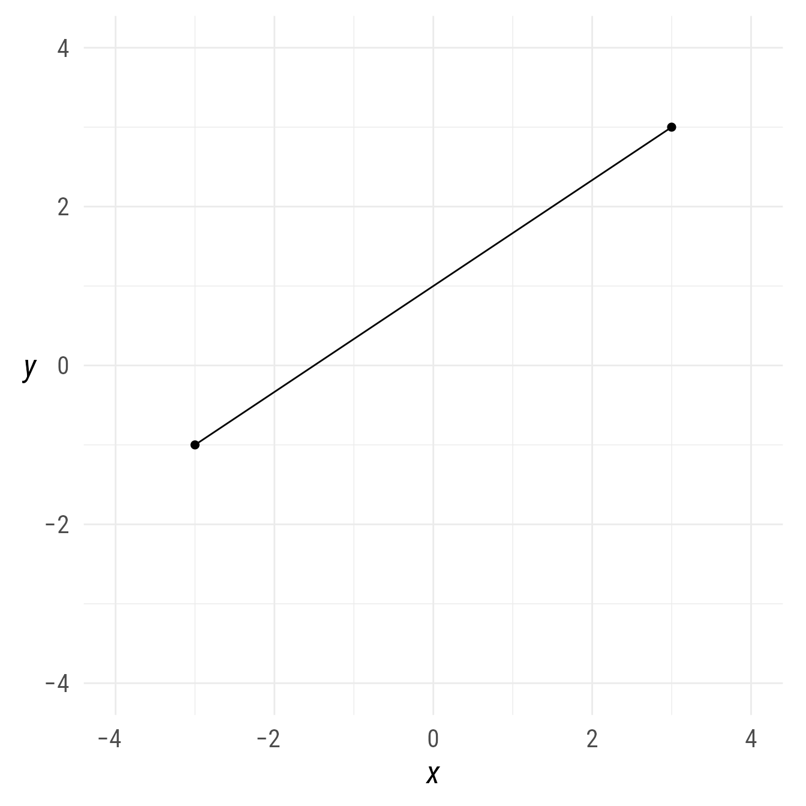

Figure 1: Plotting a segment and its endpoints

## Features of a segment

### Distance between points

``` r

s1@distance
#> [1] 7.211103
```

Alternately:

``` r

distance(s1)
#> [1] 7.211103
```

### Segment resection

Sometimes a segment looks better when it reaches close to its endpoint
but is resected a little. As seen in [Figure 2](#fig-resect), the
`resect` parameter sets the amount of resection in millimeters. If
needed, the `resect_fins` and `resect_head` parameters control the start
and and end point resection separately.

``` r

bp + 
  p1 + 
  p2 +
  ob_segment(p1, p2, resect = 3)
```

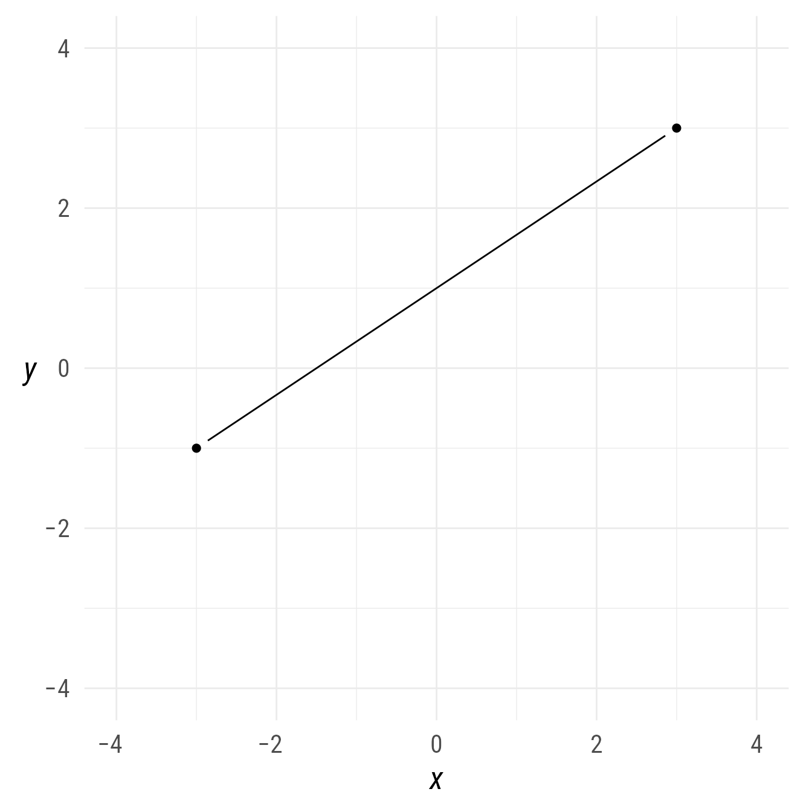

Figure 2: Plotting a resected segment between its endpoints

### Line passing through the segment

The line that passes through the segment contains information about the
segment, such as its slope, intercept, or angle.

To access the line that passes between both points:

``` r

s1@line
#> 
#> ── <ob_line>
#> # A tibble: 1 × 7
#>   slope intercept xintercept     a     b     c color
#>   <dbl>     <dbl>      <dbl> <dbl> <dbl> <dbl> <chr>
#> 1 0.667         1       -1.5    -4     6    -6 black
s1@line@slope
#> [1] 0.6666667
s1@line@intercept
#> [1] 1
s1@line@angle
#> [1] "34°"
```

Code

``` r

bp +
  s1@line |> set_props(color = "royalblue4") +
  s1@midpoint(position = c(0, 1))@label(
    polar_just = ob_polar(s1@line@angle + degree(90), 1.5),
    plot_point = TRUE) +
  ob_label(c(equation(s1@line),
             paste0("Distance = ",
                    round(s1@distance, 2))),
           center = midpoint(s1),
           vjust = c(-0.2, 1.1),
           angle = s1@line@angle)
```

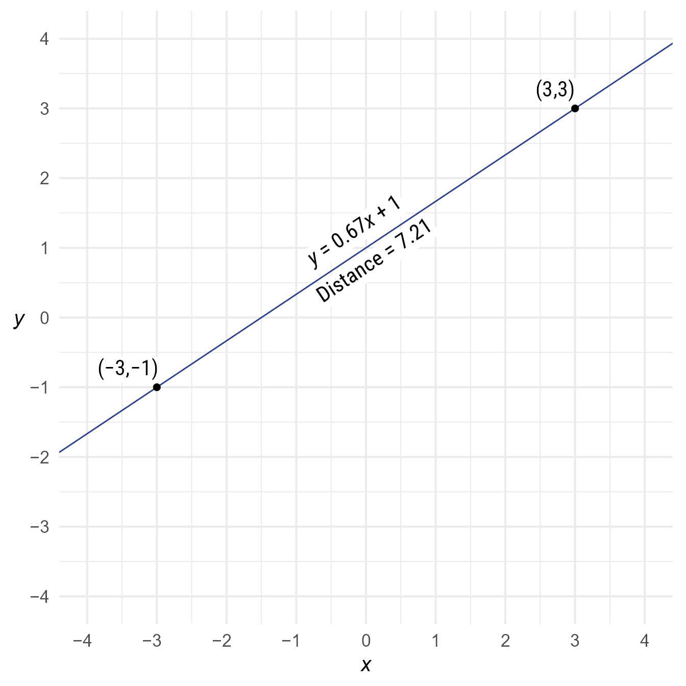

Figure 3: Line passing through segment

### Midpoints

By default, the `midpoint` function’s `position` argument is .5, which
finds the point halfway between the point of a segment:

``` r

s1@midpoint()
#> 
#> ── <ob_point>
#> # A tibble: 1 × 3
#>       x     y color
#>   <dbl> <dbl> <chr>
#> 1     0     1 black
```

Code

``` r

bp +
  s1 +
  s1@midpoint()@label("Midpoint", hjust = 0, vjust = 1) +
  s1@midpoint(c(0, 0.5, 1))@label(
    plot_point = TRUE,
    hjust = 1,
    vjust = 0)
```

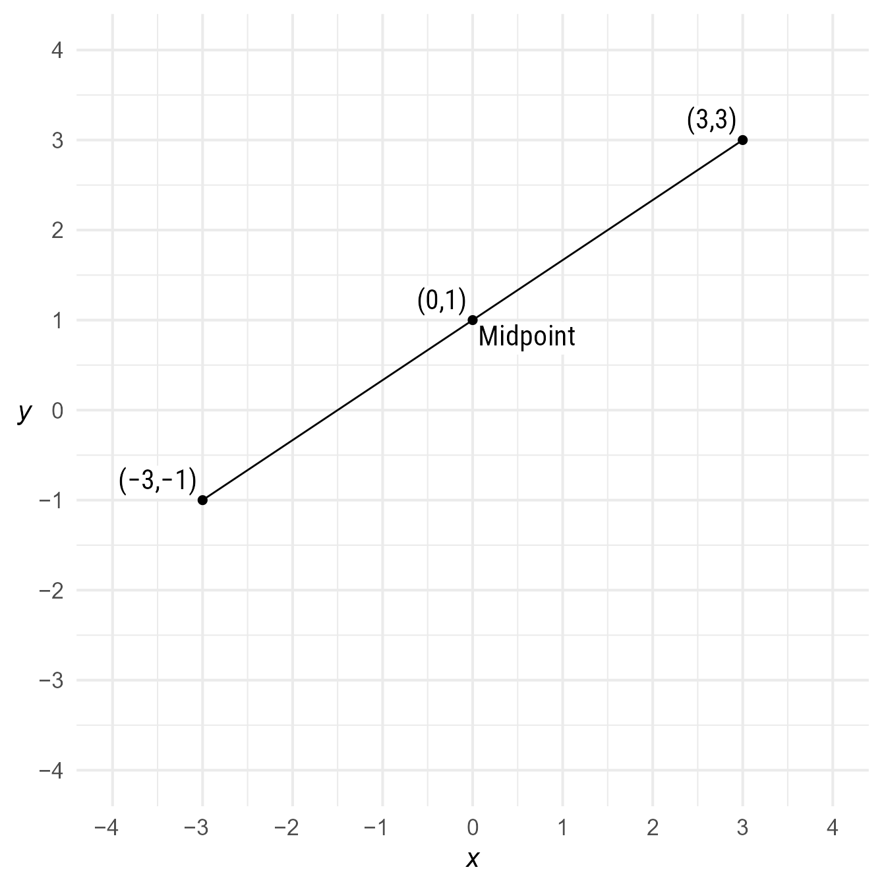

Figure 4: Midpoint of a segment

To find the midpoint 25% of the distance between the endpoints of
segment:

``` r

s1@midpoint(position = 0.25)
#> 
#> ── <ob_point>
#> # A tibble: 1 × 3
#>       x     y color
#>   <dbl> <dbl> <chr>
#> 1  -1.5     0 black
```

Code

``` r

bp +
  s1 +
  {p25 <- s1@midpoint(0.25)} +
  p25@label(
    label = c(
      p25@auto_label,
      "Midpoint a quarter the<br>way between endpoints"
    ),
    vjust = c(0, 1.05),
    hjust = c(1, 0)
  ) +
  s1@midpoint(c(0, 1))@label(plot_point = TRUE,
                             hjust = 1,
                             vjust = 0)
```

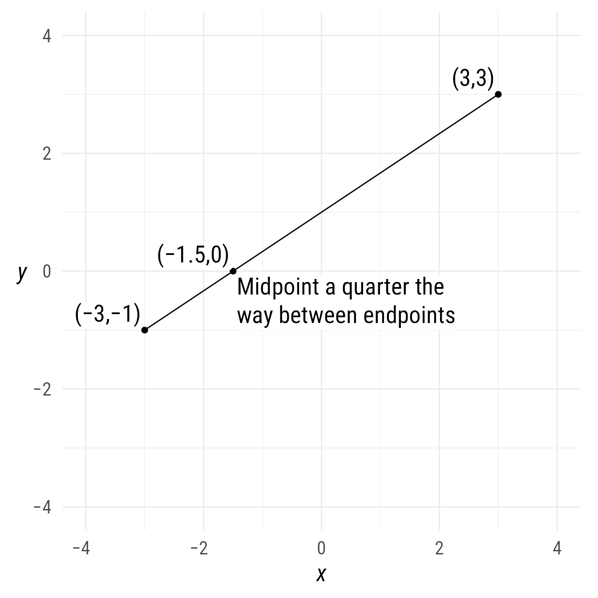

Figure 5: Midpoint

Multiple midpoints can be specified:

``` r

bp +
  s1 +
    s1@midpoint(seq(0, 1, 0.2))
```

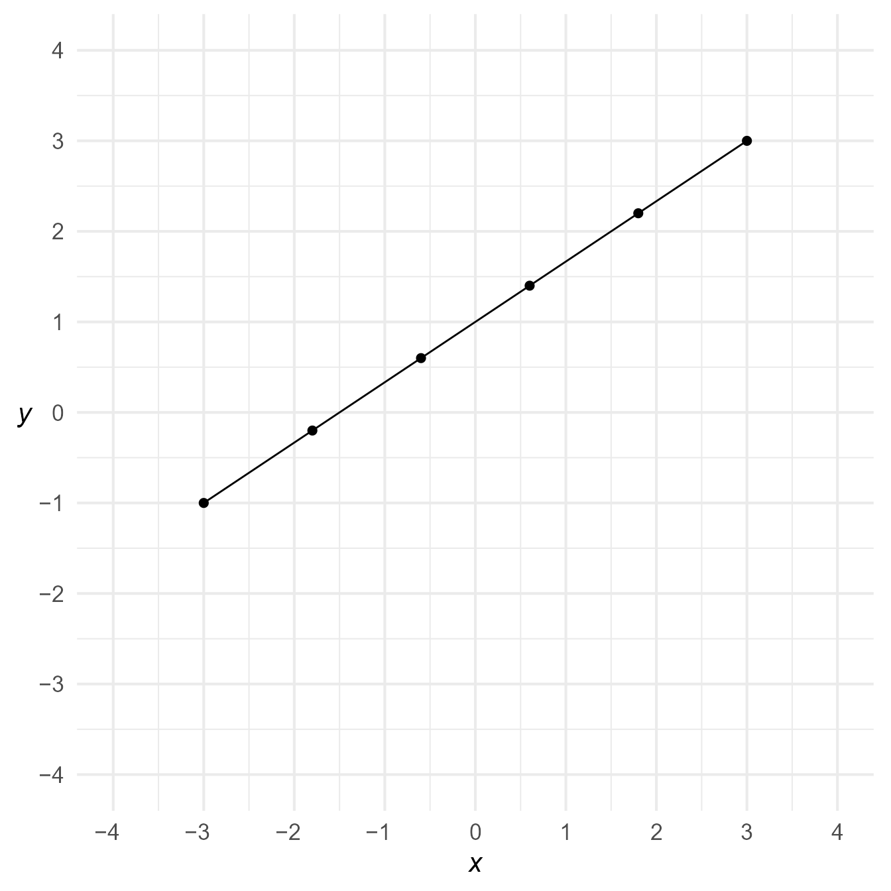

Figure 6: Selecting multiple midpoints

A quick way to get the endpoints of a segment is to specify “midpoints”
at positions 0 and 1:

``` r

bp +
  s1 +
  s1@midpoint(c(0, 1))
```


Figure 7: Selecting a segment’s endpoints via the `midpoint` property.

## Segment chains

If a point object with multiple points is placed in the `p1` slot, but
the `p2` slot is left empty, a series of segments chained together will
be created.

``` r

bp +
  ob_segment(
    ob_point(x = c(-4, -2, -1, 2, 4),
             y = c(-2, 1, -2, 3, -3)))
```

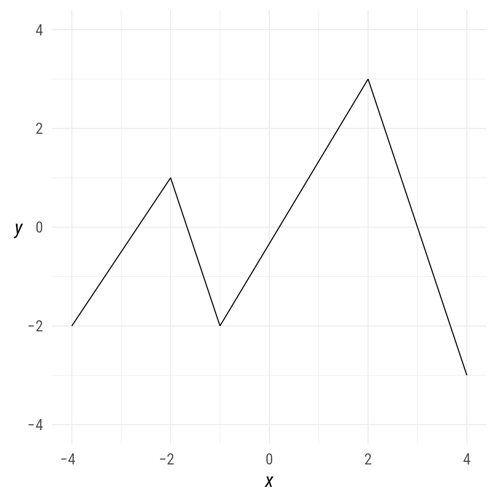

Figure 8: Chained segments

## Arrowheads and fins

In the `ob_segment` function, the `arrow_head` and `arrow_fins`
arguments can be set with any arrowhead function from the
[ggarrow](https://teunbrand.github.io/ggarrow/reference/arrow_ornaments.html)
or the [arrowheadr](https://wjschne.github.io/arrowheadr/) packages. Any
2-column matrix will also be acceptable, as shown
[here](https://teunbrand.github.io/ggarrow/articles/customisation.html).
The default arrowhead can be used via the
[`arrowhead()`](https://wjschne.github.io/ggdiagram/reference/arrowhead.md)
function. The size of the arrowhead and fins can also be controlled
independently with the `length_head` and `length_fins` arguments.

``` r

bp + ob_segment(p1, p2, 
                arrow_head = arrowhead(), 
                arrow_fins = ggarrow::arrow_fins_feather(), 
                length_head = 5,
                length_fins = 7, 
                linewidth = 2)
```

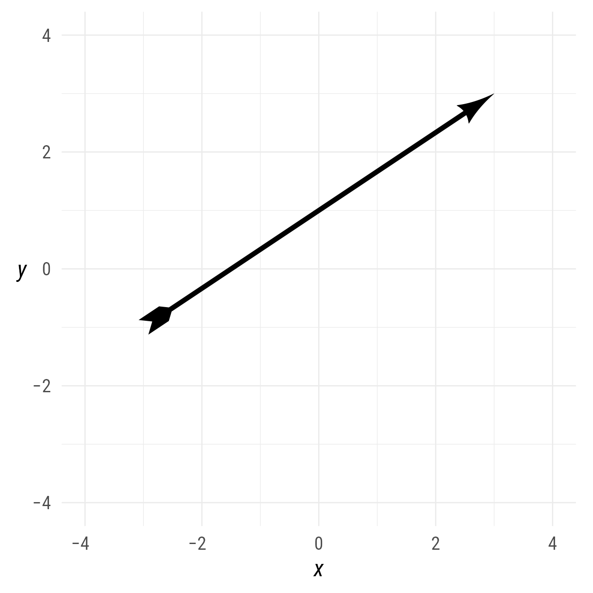

Figure 9: Segments with arrowheads and fins

## Labeling segments

By default, any label is set at the midpoint of the segment (see
[Figure 10](#fig-segmentlabel)). If it is plain text, it will be just
above the segment. Its angle will match that of the segment, but this
can be turned off by setting `label_sloped` to `FALSE`.

``` r

bp + ob_segment(p1, p2, label = "My label")
```

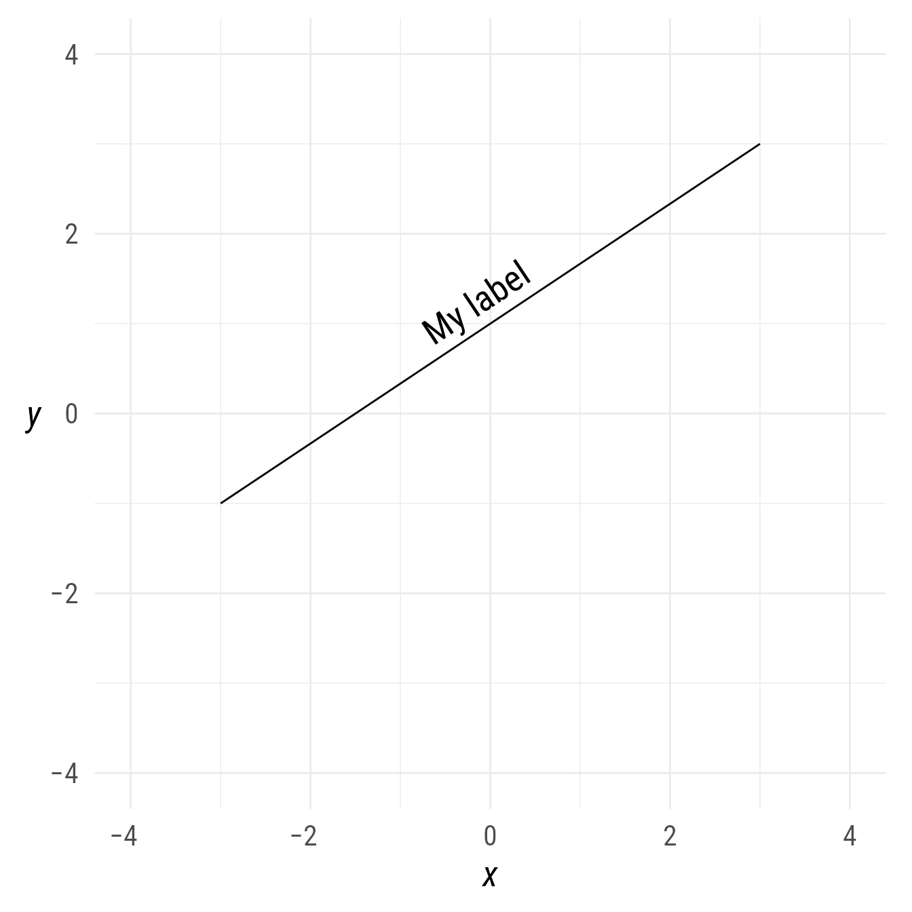

Figure 10: Segments with labels

As shown [Figure 11](#fig-segmentlabel2), the `ob_label` function gives
much more control over how and where the label will appear.

``` r

bp +
  ob_segment(
    p1,
    p2,
    label = ob_label(
      label = "My label",
      position = 0.25,
      color = "blue",
      fill = class_color("blue")@lighten(),
      family = "serif",
      vjust = -0.1,
      label.padding = ggplot2::margin(
        t = 5,
        r = 4,
        b = 3,
        l = 4
      )
    )
  )
```

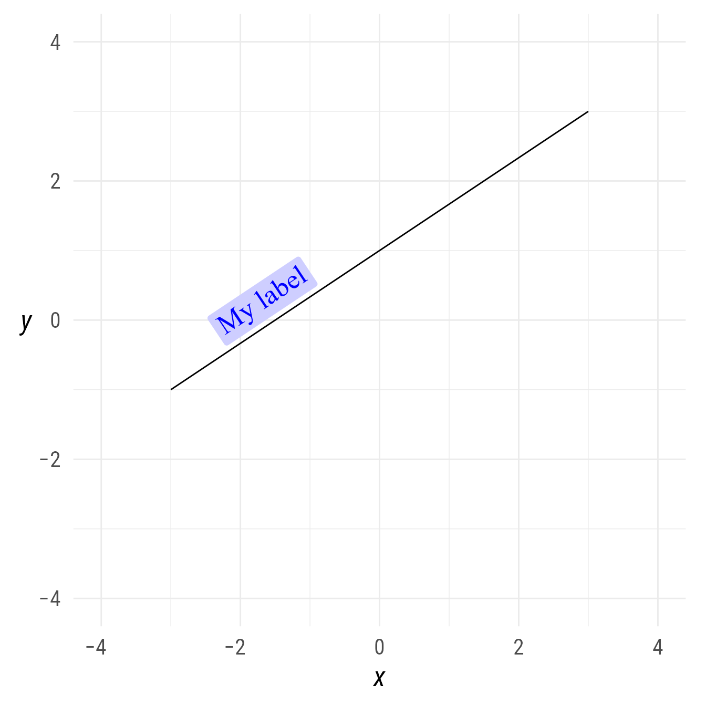

Figure 11: Segments with formatted labels

## Color Gradients

The `color_gradient` parameter makes a smooth color gradient from the
fins of an arrow to its head. It takes a vector of 2 or more colors. The
gradient is a grid gradient fill, so it requires a graphics device that
supports gradients (e.g., ragg, svg, or pdf). Because the gradient
replaces the color of the arrow’s body, set `stroke_color = NA` to hide
the arrow’s outline.

``` r

ggdiagram() +
  {c1 <- ob_circle(fill = "dodgerblue4", color = NA)} + 
  {c2 <- ob_circle(fill = "firebrick4", color = NA) |> 
    place(from = c1, where = "right", sep = 2)} + 
  ob_segment(c1@east,
             c2@west,
             arrow_head = arrowhead(),
             arrowhead_length = 4,
             linewidth = 2,
             gradient = c("dodgerblue4", "firebrick4")) 
```

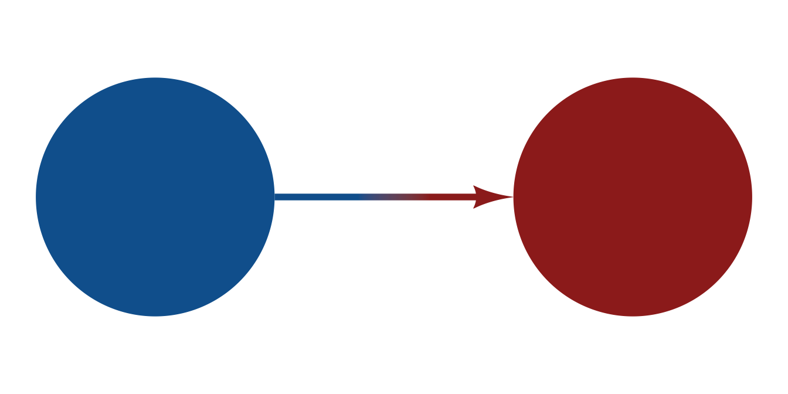

Figure 12: Segments with color gradients

Gradients are interpolated in the OKLab color space, which is more
perceptually even than RGB. A different space can be chosen for all
gradients with `options(ggdiagram.gradient_space = "oklch")` (or
`"lab"`, `"lch"`, or `"rgb"`).

Resection works as usual with gradients. Here, the segment is shortened
by 3 mm at each end, and the gradient spans the shortened arrow.

``` r

ggdiagram() +
  c1 + 
  c2 + 
  ob_segment(c1@east, 
             c2@west,
             arrow_head = arrowhead(),
             arrowhead_length = 4,
             resect = 3,
             linewidth = 2,
             gradient = c("dodgerblue4", "orchid4", "firebrick4"))
```


Figure 13: A resected segment with a three-color gradient
